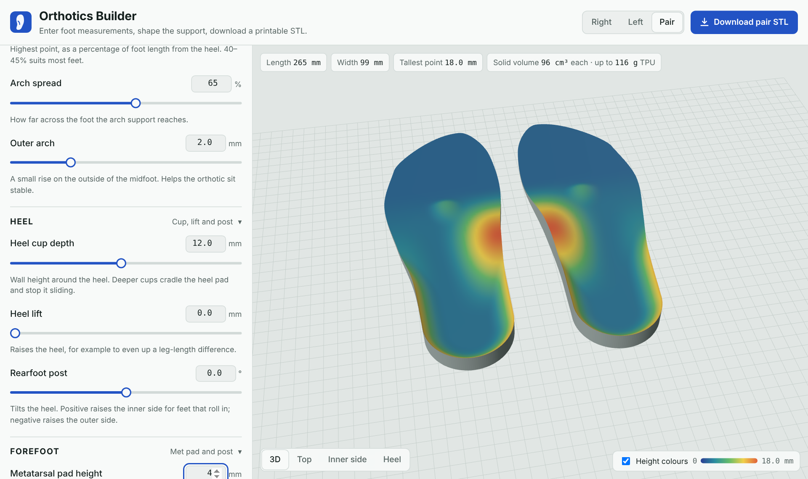

# Orthotics Builder

Design 3D-printable foot orthotics from a tape measure. No 3D scan, no CAD skills, no install. Start from your foot's length and widths, or measure an orthotic you already have. Then shape the arch, heel cup, posts and met pad with sliders, and download an STL ready for your slicer.

**Use it:** https://markusg1234.github.io/Orthotics-builder/



## What you can adjust

| Area | Settings |
|---|---|
| Your foot | Foot length, ball width, heel width, or a starting point from your shoe size (AU/UK, US, EU) |
| Length | 3/4 (ends behind the ball of the foot), sulcus (ends at the toe crease) or full length |
| Arch | Height, peak position, how far across the foot it reaches, outer arch |
| Heel | Heel cup depth, heel lift, rearfoot post angle |
| Forefoot | Metatarsal pad height and position, forefoot post angle |
| Print | Solid flat base or shell, heel/arch and forefoot thickness, material (TPU, PETG, PLA) |

The preview updates live. You can view one foot or the pair, switch to top, inner-side and heel views, and colour the surface by height. The page warns you about measurements or settings that look unusual.

**Download** gives a binary STL in millimetres. The base sits flat on Z = 0 and the toes point along +X. Choosing **Pair** puts both feet side by side in one file. **Save settings** and **Load settings** keep your values in a small JSON file so you can come back and tweak them.

## How to measure

1. Stand on a sheet of paper against a wall, with your weight on that foot.
2. Trace around the foot with the pen held upright.
3. **Length:** heel line to the tip of the longest toe.
4. **Ball width:** widest point across the ball, from the big-toe joint to the little-toe joint.
5. **Heel width:** widest point of the heel, 2–3 cm in from the back.
6. Measure both feet. They often differ by a few millimetres, so design each one with its own numbers.

The page also draws the outline it generated from your numbers, so you can lay it against your tracing.

## Copy an existing orthotic

Have an orthotic that already works for you, from a podiatrist or a shop? Open **Copy an existing orthotic** at the top of the settings, measure it, and the designer sets itself to match. You need a flat table, paper, a pen, a steel rule, and digital calipers if you have them. All measurements are in millimetres.

1. Note where it ends: behind the ball of the foot (3/4), at the toe crease (sulcus) or full length. Check whether the underside is flat or hollow under the arch.
2. Lay it flat on paper and trace around it with the pen held upright. From the tracing, measure:
   1. **Overall length:** back of the heel to the front tip.
   2. **Widest width:** the widest point of the tracing.
   3. **Heel width:** across the heel, 2–3 cm in from the back.
3. Put the orthotic on the table. Measure these heights from the table up to the top surface, with the calipers' depth rod or a steel rule stood on end:
   4. **Heel seat height:** the middle of the heel seat.
   5. **Heel rim height:** the top of the heel cup at the very back.
   6. **Arch height:** the top of the inner edge where the arch is highest.
4. Measure along the tracing:
   7. **Arch position:** from the back of the heel to that highest point.
5. For toe-crease and full-length orthotics, measure the **forefoot thickness** (8) under the ball with calipers.
6. Optional, only if your orthotic has them:
   - **Met pad height and position** (9, 10): the dome's height above the surface around it, and the distance from the back of the heel to its centre.
   - **Heel lift pad** (11): the thickness of a separate pad stuck under the heel.
   - **Wedges** (12, 13): for a wedge under the heel or the forefoot, its thickness at the inner and outer edges and its width across the foot. The tool turns these into post angles.
7. Press **Match this orthotic**. The tool works out the settings, then shows your measurements next to the same measurements of the new design so you can check they line up. Fine-tune with the sliders afterwards.

The match is as good as the measurements. Shapes this tool doesn't model, such as a deep skive or an unusual outline, come out as the closest design it can make.

## Printing

| Material | Suggested settings |
|---|---|
| TPU 95A | 2–3 walls, 15–25% gyroid infill, 20–30 mm/s. Flexible and durable, the best all-round choice. |
| PETG | 4 walls, 30–40% infill. Firm shell, add a foam top cover for comfort. |
| PLA | Good for test fits only. It cracks under repeated flexing. |

Print with the flat base on the bed. The solid style needs no supports. The shell style is hollow under the arch and needs supports there.

Start with a modest arch (10–15 mm for most adults), wear the orthotic for a few days, then go up 2 mm at a time.

## How it works

The geometry engine (`src/geometry.js`) is plain JavaScript with no dependencies:

- **Outline.** The inner and outer edges come from monotone cubic curves fitted through stations along the foot, scaled from your length, ball width and heel width. The heel is rounded, and the end of the orthotic is shaped for the length you chose. The big toe is longest at full length, and the 3/4 and sulcus ends follow the slant of the metatarsal heads.
- **Height field.** The top surface adds up the base thickness, the posts and lifts, the arch (a cosine profile along the foot times a smooth ramp across it), the heel cup (a function of true distance to the edge), and the met pad (a teardrop dome). The heel cup and the arch are blended with a smooth maximum so the cup wall flows into the arch instead of stacking on it.
- **Mesh.** A 150 × 56 grid, denser near the ends and edges, becomes a top surface, a bottom surface (flat, or following the arch for the shell style) and side walls. The result is a closed, consistently wound mesh. Left feet are mirrored from right feet.

The page (`src/app.html`) uses [three.js](https://threejs.org/) for the preview and [JSZip](https://stuk.github.io/jszip/) for packaged downloads, both loaded from public CDNs.

## Development

```bash
python3 build.py              # inline src/geometry.js into src/app.html → index.html
node tests/check_mesh.js      # watertightness and sanity checks across many settings
python3 build.py --check      # confirm index.html matches the sources
```

Edit the files in `src/`, then run `build.py`. `index.html` is generated and is what GitHub Pages serves. CI runs the mesh checks and the up-to-date check on every push.

To run it locally, open `index.html` in a browser, or serve the folder with `python3 -m http.server`.

## Safety

These are general-purpose supports, not a medical device, and this tool does not diagnose or treat anything. If you have diabetes, poor circulation, numbness or ongoing foot pain, see a podiatrist before using orthotics you have made yourself. A podiatrist can also give you the arch height and post angles to enter here.

## Licence

MIT. See [LICENSE](LICENSE).
